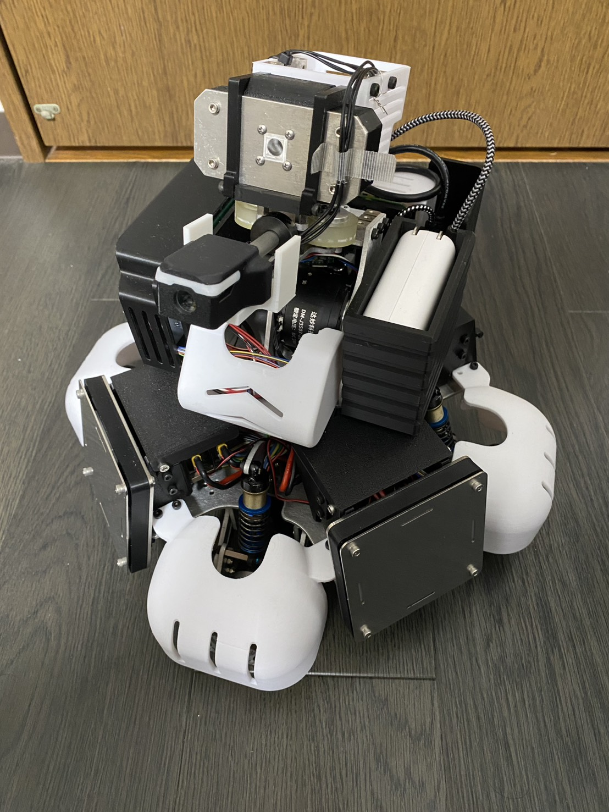
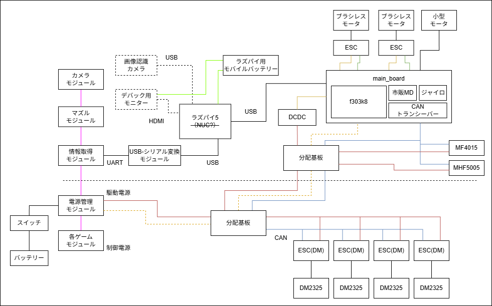

# beta

ATTRACTS 向け対戦ロボット beta（alpha の次世代機）の機体管理リポジトリ。
機体全体の構成、基板、配線、関連リポジトリへの入口をここに集約する。



## 関連リポジトリ

| 役割 | リポジトリ | 備考 |
|---|---|---|
| 制御基板 | [beta_main_pcb](https://github.com/rabbits-robotics/beta_main_pcb) | [v1.0](https://github.com/rabbits-robotics/beta_main_pcb/releases/tag/v1.0)（2026-01-29 発注） |
| 車体分配基板 | [beta_chassis_pcb](https://github.com/rabbits-robotics/beta_chassis_pcb) | [v1.0](https://github.com/rabbits-robotics/beta_chassis_pcb/releases/tag/v1.0)（2026-01-22 発注） |
| 制御基板ファームウェア | [beta_main](https://github.com/rabbits-robotics/beta_main) | Nucleo F303K8、PlatformIO + stm32pio |
| 通信モジュール（M5Stack） | [m5_basic_2_7_attracts](https://github.com/rabbits-robotics/m5_basic_2_7_attracts) | ゲームモジュールのトランシーバと STM32 の中継 |
| 共通ライブラリ | [rabcl](https://github.com/rabbits-robotics/rabcl) | ファームと ROS 2 で共用。コミット固定 |
| ROS 2 ワークスペース | [rabbits_ws](https://github.com/rabbits-robotics/rabbits_ws) | `beta.repos` を使う（作成予定） |
| 機体固有設定（launch / パラメータ / URDF） | [rabbits_description](https://github.com/rabbits-robotics/rabbits_description) | |
| メカ CAD | 本リポジトリの Releases | SolidWorks 一式を zip で添付（CERN-OHL-P-2.0）。添付予定 |

## 環境構築（Raspberry Pi 側）

```bash
git clone https://github.com/rabbits-robotics/rabbits_ws.git
cd rabbits_ws
vcs import src < beta.repos
colcon build
```

`beta.repos` は `vcs export --exact src` で生成したコミット固定版。rabcl は beta_main の submodule と同じコミットを指す。

## システム構成

Nucleo F303K8 を 1 枚に統合し、Raspberry Pi 5 からの UART 指令を受けて CAN 1 系統で全モータを直接制御する。

```
[ Raspberry Pi 5 ]
  │ UART（USB-シリアル変換経由、DMA）
  ▼
[ beta_main（Nucleo F303K8） ]  ← BNO055 IMU
  ├── CAN（1 Mbps）
  │     ├── MHF5005（LK）  → 首 Yaw 軸（ID 0x141）
  │     ├── MF4015（LK）   → 首 Pitch 軸（ID 0x142）
  │     └── DM2325 × 4（DAMIAO） → オムニ 4 輪（SlaveID 0x43〜0x46）
  ├── PWM × 2 → ESC → 射出ローラー × 2
  ├── PWM → 装填モータ（DRV8835）
  └── PWM → 小型モータ（市販 MD）
```



配線図の元ファイルは [diagrams/wiring_diagram.drawio](./diagrams/wiring_diagram.drawio)。

## 基板構成

| 基板 | 役割 |
|---|---|
| beta_main | 制御基板。Nucleo F303K8、CAN トランシーバ（MCP2562）、装填モータドライバ（DRV8835）、BNO055 を載せ、外部 DCDC への電源往復とモータ・ESC のコネクタをまとめる |
| beta_chassis | 車体側の受動分配基板。電源を車輪 ESC 4 台に分配し、CAN を分配する |

### 基板間接続

| 区間 | 内容 |
|---|---|
| beta_main ⇔ beta_chassis | スリップリング経由。電源、CAN |
| beta_chassis → 車輪 ESC × 4 | XT30 電源、PH 2P CAN |

## アクチュエータ一覧

| 部位 | モータ | バス |
|---|---|---|
| 首 Yaw | MHF5005（LK）、位置制御 | CAN 0x141 |
| 首 Pitch | MF4015（LK）、位置制御 | CAN 0x142 |
| 車輪 | DM2325 × 4（DAMIAO、減速比 25）、オムニ 4 輪、速度制御 | CAN 0x200 + SlaveID |
| 射出 | ESC × 2 | PWM 50 Hz。待機 1000 µs / 射出 1200 µs |
| 装填 | DC モータ（DRV8835） | PWM 1 kHz |
| 小型モータ | DC モータ（市販 MD） | PWM + GPIO |

## 共通仕様

| 項目 | 値 |
|---|---|
| 上位コントローラ | Raspberry Pi 5（UART） |
| CAN ビットレート | 1 Mbps |
| 制御周期 | 100 Hz |
| CAN 送信 | 1500 Hz のラウンドロビン（モータあたり約 500 Hz） |

## alpha からの変更点

| 項目 | alpha（proto2） | beta |
|---|---|---|
| ボード構成 | Nucleo 4 枚（turret / yaw / main / chassis） | **Nucleo 1 枚（beta_main）** |
| 車輪モータ | JGA25-370 × 4（PWM + エンコーダ） | **DM2325 × 4（DAMIAO CAN）** |
| Yaw 軸モータ | JGA25-370（PWM + エンコーダ + BNO055） | **MHF5005（LK モータ、CAN）** |
| Pitch 軸モータ | LD-20MG サーボ（PWM） | **MF4015（LK モータ、CAN）** |
| CAN ビットレート | 400 kbps | **1 Mbps** |
| システムクロック | 8 MHz | **36 MHz** |

## 写真

| | |
|---|---|
| [側面](images/beta_side.jpg) | [電源スイッチとヒューズ](images/beta_power_switch_fuse.jpg) |
| [底面](images/beta_bottom.jpg) | [底面（バッテリー装着）](images/beta_bottom_battery.jpg) |
| [底面（バッテリーボックス開）](images/beta_bottom_battery_open.jpg) | [底面 2](images/beta_bottom_2.jpg) |

## 設計メモ

機体全体に関わる設計判断は `docs/` に日付付きで残す。

## ライセンス

このリポジトリの文書は © Rabbits Robotics、[CC BY 4.0](./LICENSE)。
Releases に添付するメカ CAD は CERN-OHL-P-2.0（リリースノートに明記）。
