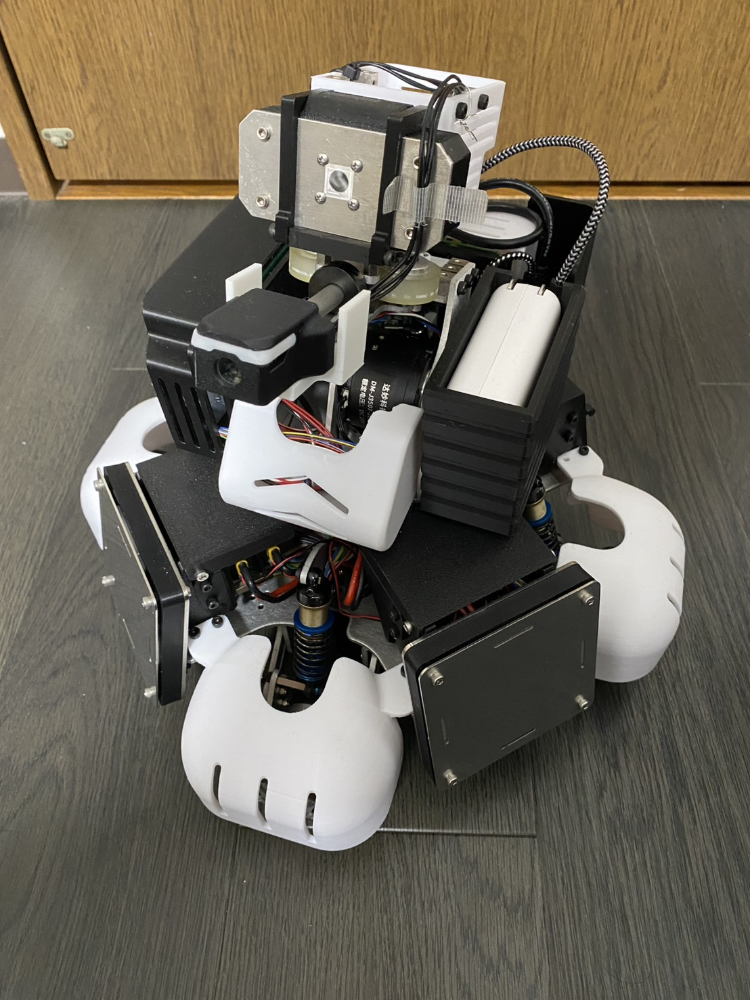
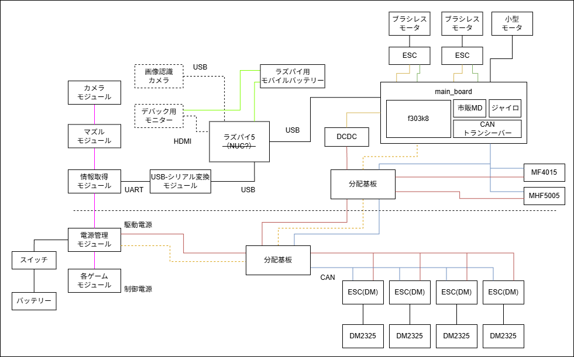

# beta

ATTRACTS 向け対戦ロボット beta（alpha の次世代機）の機体管理リポジトリ。
機体全体の構成、基板、配線、関連リポジトリへの入口をここに集約する。



## 関連リポジトリ

| 役割 | リポジトリ | 備考 |
|---|---|---|
| 制御基板 | [beta_main_pcb](https://github.com/rabbits-robotics/beta_main_pcb) | [v1.0](https://github.com/rabbits-robotics/beta_main_pcb/releases/tag/v1.0)（2026-01-29 発注） |
| 車体分配基板 | [beta_chassis_pcb](https://github.com/rabbits-robotics/beta_chassis_pcb) | [v1.0](https://github.com/rabbits-robotics/beta_chassis_pcb/releases/tag/v1.0)（2026-01-22 発注） |
| 制御基板ファームウェア | [beta_main](https://github.com/rabbits-robotics/beta_main) | Nucleo F303K8、PlatformIO + stm32pio |
| 通信モジュール（M5Stack） | [m5_basic_2_7_attracts](https://github.com/rabbits-robotics/m5_basic_2_7_attracts) | ゲームモジュールのトランシーバと STM32 の中継 |
| 共通ライブラリ | [rabcl](https://github.com/rabbits-robotics/rabcl) | ファームと ROS 2 で共用。コミット固定 |
| ROS 2 ワークスペース | [rabbits_ws](https://github.com/rabbits-robotics/rabbits_ws) | `beta.repos`（Pi 5 の最終状態をコミット固定。2026-11-16 作成） |
| ROS 2 パッケージ | [rabbits_bridge](https://github.com/rabbits-robotics/rabbits_bridge) / [rabbits_interface](https://github.com/rabbits-robotics/rabbits_interface) / [rabbits_description](https://github.com/rabbits-robotics/rabbits_description) / [rabbits_msgs](https://github.com/rabbits-robotics/rabbits_msgs) / [rabcl_ros2](https://github.com/rabbits-robotics/rabcl_ros2) | beta 当時は attracts_bridge / attracts_interface / attracts_description / attracts_msgs（ワークスペースは attracts_ws）。改名後も履歴は同じリポジトリに続いている |
| メカ CAD | 本リポジトリの Releases | SolidWorks 一式を zip で添付（CERN-OHL-P-2.0）。添付予定 |

## 環境構築（Raspberry Pi 側）

```bash
git clone https://github.com/rabbits-robotics/rabbits_ws.git
cd rabbits_ws
vcs import src < beta.repos
colcon build
```

`beta.repos` は Pi 5 に入っていた最終状態のコミット固定版（下記）。パッケージ名は attracts_* のままなので gamma の rabbits_* と同じ `src` に混ぜない。

### Pi 5 の最終状態（2026-11-16 に保全）

2026 年の出場後そのままだった Raspberry Pi 5（Ubuntu 24.04.2、ROS 2 Jazzy、NVMe SSD 起動、ホスト名 `raspberry-pi-5-8`）の中身を gamma に転用する前に記録した。

| 項目 | 内容 |
|---|---|
| ワークスペース | `~/attracts_ws`（[rabbits_ws](https://github.com/rabbits-robotics/rabbits_ws) の履歴内 6ff29d1。src は `default_package_list.repos` で別クローン） |
| attracts_bridge | rabbits_bridge **8f350dd**（ブランチ `beta-pi-final`。試合当日の未コミット調整: launch で game_client を有効化・transceiver bridge を無効化、デバイス名を udev の `/dev/ttySTM32` / `/dev/ttyTransceiver` に。親は a4f8d87） |
| attracts_interface | rabbits_interface **a2d8a46**（ブランチ `beta-pi-final`。試合当日の未コミット調整: `joy_linux` → `joy`、マウスの yaw / pitch の符号反転、射出を右クリック → Alt / Space、V キーで速度 2 倍。親は 41e76bd） |
| attracts_description / attracts_msgs | rabbits_description 4040d8e / rabbits_msgs 4e4d52a |
| rabcl / rabcl_ros2 | 979e239 / 85bc1f9 |
| udev | `/etc/udev/rules.d/99-attracts-serial.rules`（下記） |
| 起動時の自動起動 | systemd のシステムサービス `/etc/systemd/system/ros2_launch.service`（下記。`multi-user.target` で有効、ユーザー `kota0314` で起動 10 秒後に `ros2 launch attracts_bridge stm32_bringup.launch.py`、失敗時 5 秒で再起動、出力は `~/ros2_launch.log` に追記） |
| リモート | SSH（鍵）と GNOME のリモートデスクトップ（`gnome-remote-desktop` が有効、README 上部の RDP の項） |
| Bluetooth | PS4 互換パッド「Wireless Controller」（1C:66:6D:CC:CB:0B）とキーボード ELECOM TK-DCP03 をペアリング済み |
| 無線 | Wi-Fi は `rfkill` でソフトブロック（試合中の無線禁止）、Bluetooth は有効 |
| その他 | `~/.bashrc` が `/opt/ros/jazzy` と `~/attracts_ws/install` を source、`~/.pio-venv` に PlatformIO 6.1.19、最後の launch ログは 2026-06-23 |

```
# /etc/udev/rules.d/99-attracts-serial.rules
SUBSYSTEM=="tty", ATTRS{idVendor}=="1a86", ATTRS{idProduct}=="55d4", ATTRS{serial}=="5567027502", SYMLINK+="ttyTransceiver"
SUBSYSTEM=="tty", ATTRS{idVendor}=="0483", ATTRS{idProduct}=="374b", ATTRS{serial}=="066DFF505682884967245827", SYMLINK+="ttySTM32"
```

```ini
# /etc/systemd/system/ros2_launch.service
[Unit]
Description=ROS2 Launch Service
After=network.target

[Service]
User=kota0314
Group=kota0314
WorkingDirectory=/home/kota0314
ExecStart=/usr/bin/bash -i -c "sleep 10 && source /opt/ros/jazzy/setup.bash && source /home/kota0314/attracts_ws/install/setup.bash && ros2 launch attracts_bridge stm32_bringup.launch.py"
Restart=on-failure
RestartSec=5
StandardOutput=append:/home/kota0314/ros2_launch.log
ProtectHome=false
AmbientCapabilities=CAP_NET_ADMIN CAP_NET_RAW

[Install]
WantedBy=multi-user.target
```

メモ: 2026-11-16 の `apt upgrade` 後の再起動で SSH のホスト鍵が作り直された（cloud-init が「新しいインスタンス」として初回起動の処理を走らせたため。`/var/lib/cloud/instances/nocloud`）。PC 側の `known_hosts` を更新した。gamma 用に組み直すときは `sudo touch /etc/cloud/cloud-init.disabled` で cloud-init を止めておく。

## システム構成

Nucleo F303K8 を 1 枚に統合し、Raspberry Pi 5 からの UART 指令を受けて CAN 1 系統で全モータを直接制御する。

```
[ Raspberry Pi 5 ]
  │ UART（USB-シリアル変換経由、DMA）
  ▼
[ beta_main（Nucleo F303K8） ]  ← BNO055 IMU
  ├── CAN（1 Mbps）
  │     ├── MHF5005（LK）  → 首 Yaw 軸（ID 0x141）
  │     ├── MF4015（LK）   → 首 Pitch 軸（ID 0x142）
  │     └── DM2325 × 4（DAMIAO） → オムニ 4 輪（SlaveID 0x43〜0x46）
  ├── PWM × 2 → ESC → 射出ローラー × 2
  ├── PWM → 装填モータ（DRV8835）
  └── PWM → 小型モータ（市販 MD）
```



配線図の元ファイルは [diagrams/wiring_diagram.drawio](./diagrams/wiring_diagram.drawio)。

## 基板構成

| 基板 | 役割 |
|---|---|
| beta_main | 制御基板。Nucleo F303K8、CAN トランシーバ（MCP2562）、装填モータドライバ（DRV8835）、BNO055 を載せ、外部 DCDC への電源往復とモータ・ESC のコネクタをまとめる |
| beta_chassis | 車体側の受動分配基板。電源を車輪 ESC 4 台に分配し、CAN を分配する |

### 基板間接続

| 区間 | 内容 |
|---|---|
| beta_main ⇔ beta_chassis | スリップリング経由。電源、CAN |
| beta_chassis → 車輪 ESC × 4 | XT30 電源、PH 2P CAN |

## アクチュエータ一覧

| 部位 | モータ | バス |
|---|---|---|
| 首 Yaw | MHF5005（LK）、位置制御 | CAN 0x141 |
| 首 Pitch | MF4015（LK）、位置制御 | CAN 0x142 |
| 車輪 | DM2325 × 4（DAMIAO、減速比 25）、オムニ 4 輪、速度制御 | CAN 0x200 + SlaveID |
| 射出 | ESC × 2 | PWM 50 Hz。待機 1000 µs / 射出 1200 µs |
| 装填 | DC モータ（DRV8835） | PWM 1 kHz |
| 小型モータ | DC モータ（市販 MD） | PWM + GPIO |

## 共通仕様

| 項目 | 値 |
|---|---|
| 上位コントローラ | Raspberry Pi 5（UART） |
| CAN ビットレート | 1 Mbps |
| 制御周期 | 100 Hz |
| CAN 送信 | 1500 Hz のラウンドロビン（モータあたり約 500 Hz） |

## alpha からの変更点

| 項目 | alpha（proto2） | beta |
|---|---|---|
| ボード構成 | Nucleo 4 枚（turret / yaw / main / chassis） | **Nucleo 1 枚（beta_main）** |
| 車輪モータ | JGA25-370 × 4（PWM + エンコーダ） | **DM2325 × 4（DAMIAO CAN）** |
| Yaw 軸モータ | JGA25-370（PWM + エンコーダ + BNO055） | **MHF5005（LK モータ、CAN）** |
| Pitch 軸モータ | LD-20MG サーボ（PWM） | **MF4015（LK モータ、CAN）** |
| CAN ビットレート | 400 kbps | **1 Mbps** |
| システムクロック | 8 MHz | **36 MHz** |

## 写真

| | |
|---|---|
| [側面](images/beta_side.jpg) | [電源スイッチとヒューズ](images/beta_power_switch_fuse.jpg) |
| [底面](images/beta_bottom.jpg) | [底面（バッテリー装着）](images/beta_bottom_battery.jpg) |
| [底面（バッテリーボックス開）](images/beta_bottom_battery_open.jpg) | [底面 2](images/beta_bottom_2.jpg) |

## 設計メモ

機体全体に関わる設計判断は `docs/` に日付付きで残す。

## ライセンス

このリポジトリの文書は © Rabbits Robotics、[CC BY 4.0](./LICENSE)。
Releases に添付するメカ CAD は CERN-OHL-P-2.0（リリースノートに明記）。
