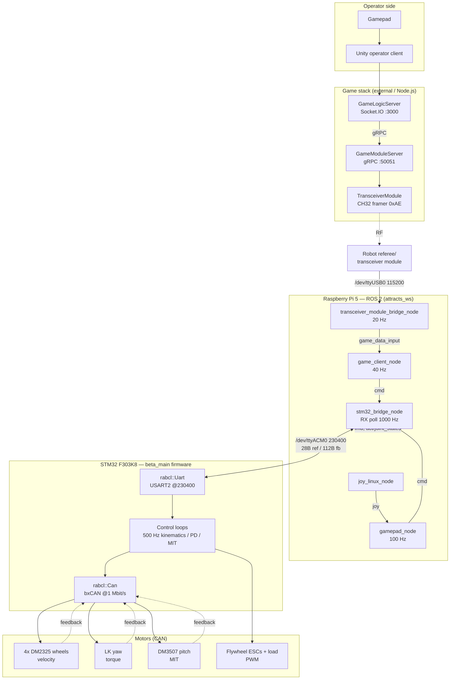

# Rabbits — System Architecture Overview

**Status:** Current-state snapshot, reverse-engineered from source. Intended as a shared reference for design discussions, not a spec.

**Date:** 2026-07-19
**Scope:** `attracts_ws` (ROS 2), `stm_ws` (STM32 firmware), `rabcl` (shared comms library), `dm-tools` (Damiao motor tooling), `ATTRACTS_SimpleClient` (game server).

> **Accuracy note.** Everything below is grounded in the actual code. Claims are tagged **[C]** = confirmed in source, **[D]** = derived by arithmetic from config values (not written as a literal), or **[I]** = inferred from naming/structure. A companion deep-dive on the ROS 2 workspace lives in [`attracts_ws_architecture.md`](./2026-07-19-attracts_ws_architecture.md).

---

## 1. System overview

Rabbits is a **teleoperated combat/attraction robot** built for a projectile/laser robot-battle game called **ATTRACTS**. A human operator drives the robot; the robot has an omnidirectional chassis, a gimbal (yaw + pitch), and a firing subsystem (flywheels + a feed/load motor). A separate game-logic server tracks match state (HP, heat, team, role) and can push game data to the robot over an RF link.

Physically the robot is organized around two computers and a smart-motor CAN bus:

- A **Raspberry Pi 5** [I] runs the ROS 2 stack: it reads operator input (gamepad or game-server input), computes chassis/gimbal commands, and talks to the microcontroller over USB serial.
- An **STM32 F303K8** (Nucleo-32) [C] runs the real-time firmware: it parses commands from the Pi, runs the control loops, drives the motors over a CAN bus, and streams IMU + motor feedback back to the Pi.
- The **motors** are smart CAN actuators — Damiao (DM) servos for the wheels and pitch, and an LK/MyActuator gimbal motor for yaw — plus PWM-driven ESCs for the flywheels and a feed motor.

There are, in practice, **two robot generations** in the tree [C]:

- **beta generation** (`beta_main`) — the current single-board, all-in-one design using the 28/112-byte rabcl protocol and smart CAN motors. This memo treats it as the reference architecture.
- **proto2 generation** (`proto2_turret` / `proto2_yaw` / `proto2_main`) — an older 3-board distributed design linked by an internal CAN bus, driving brushed DC motors. Retained for context; some of its CAN reference IDs still have a compatibility path in `beta_main`.

There are also **two independent communication stacks** that should not be confused [C]:

1. The **rabcl stack** — Pi ⇄ STM32 ⇄ motors (the robot's own control path).
2. The **ATTRACTS game stack** — Unity operator client ⇄ GameLogicServer ⇄ GameModuleServer ⇄ a CH32 RF transceiver ⇄ robot. This delivers game state and an alternate keyboard/mouse input channel; it uses entirely different framing.

---

## 2. Component / responsibility breakdown

### Raspberry Pi 5 (ROS 2 host) [I for the specific board; ROS 2 stack is C]
Runs the `attracts_ws` ROS 2 nodes. Responsibilities:
- Ingest operator input (`joy` from a gamepad, or `game_data_input` from the transceiver module).
- Convert input into a unified `AttractsCommand` (chassis velocity, yaw/pitch targets, fire/load/speed/chassis modes).
- Serialize commands into the rabcl UART "reference" frame and write them to the STM32 over `/dev/ttyACM0` @ 230400.
- Read the rabcl UART "feedback" frame from the STM32 and republish it as `sensor_msgs/Imu` and `sensor_msgs/JointState`.
- Read the referee/transceiver module on `/dev/ttyUSB0` @ 115200 and publish game data.

### STM32 F303K8 (`beta_main` firmware) [C]
The real-time controller. Responsibilities:
- Receive 28-byte reference frames from the Pi over USART2 (DMA RX), validate, and decode into the shared `rabcl::Info` state object.
- Run control loops on a ~1500 Hz timer base, with software-divided sub-rates: 500 Hz for the omni-drive kinematics, yaw PD, and pitch MIT command; 100 Hz for fire/load PWM and feedback TX.
- Emit CAN frames to the motors round-robin (one frame per ~1500 Hz tick → ~250 Hz per motor [D]).
- Read CAN feedback from motors (FIFO0 interrupt) into `rabcl::Info`.
- Assemble the 112-byte feedback frame and transmit it to the Pi at 100 Hz.
- Drive fire flywheel ESCs (TIM1, 50 Hz PWM) and the load motor (TIM3 PWM + direction GPIO), including an ESC arming sequence at boot.

### ROS 2 nodes (in `attracts_ws`) [C]
Four nodes total (details in the companion doc):
- `gamepad_node` — gamepad → `cmd` (`AttractsCommand`) at 100 Hz.
- `game_client_node` — game-server input → `cmd` at 40 Hz (alternate driver).
- `stm32_bridge_node` — `cmd` ↔ STM32 UART; publishes `imu`, `act/joint_states`.
- `transceiver_module_bridge_node` — referee/transceiver serial → `game_data_input`, `game_data_robot` at 20 Hz.

### Motors (CAN bus, `beta_main`) [C]
| Axis | Motor | Count | CAN ID (TX / RX) | Control mode |
|---|---|---|---|---|
| Chassis omni wheels | Damiao DM2325 (GR 25) | 4 | 0x243–0x246 / 0x53–0x56 | Velocity (rad/s) |
| Yaw | LK / MyActuator (RMD-style) | 1 | 0x141 | Torque/current, host-side PD |
| Pitch | Damiao DM3507 (GR 7) | 1 | 0x42 / 0x52 | MIT (internal PD + gravity FF) |
| Fire flywheels | ESC-driven BLDC | 2 | TIM1 PWM 50 Hz (PA8/PA9) | Open-loop throttle |
| Load / feed | Brushed DC | 1 | TIM3 PWM + dir GPIO | Open-loop |

DM enable frames (`FF…FC`) are re-sent about every 0.5 s [C]. The MIT-mode pitch command uses a gravity feed-forward term (`PdGravityFf`) [C].

### Game server (`ATTRACTS_SimpleClient` / GameLogicServer) [C]
Node.js/TypeScript server (Node ≥22, ESM). Sits between the Unity operator client and the physical robots:
- **Unity ⇄ server:** Socket.IO on port 3000 (events: `selectUnit`, `setRole`, `setTeam`, `input`, etc.; outbound `unitList`, `unitStatus`, `hitEvent`, `shotEvent`).
- **Server ⇄ robot hardware:** gRPC (nice-grpc, ts-proto) to a separate **GameModuleServer** at 192.168.10.103:50051, with server-streaming subscriptions for shot/hit/UART/power/camera events, and unary calls to send framed data.
- A 50 Hz main loop discovers each robot by its CameraModule hardware number and, every 20 ms per unit, updates HP/heat and pushes two payloads to the robot through its TransceiverModule: `DataInput` (9 bytes, cmd 0x00) and `DataRobot` (11 bytes, cmd 0x01).
- The GameModuleServer binary and the robot-side RF firmware are **external to this repo** [I]; only the generated gRPC client stub is present.

### rabcl (shared library) [C]
"Rabbits Common Library" — a portable, dependency-light C++ library that is compiled into **both** the ROS 2 workspace (as an ament package) and the STM32 firmware (as a PlatformIO `lib/`). It is the single source of truth for the UART and CAN wire formats, plus component drivers (IMU, DC motor, servo) and controllers (`omni_drive`, `pd_gravity_ff`). The central `rabcl::Info` struct is the shared data model both interfaces read and write.

### dm-tools [C]
Vendor (Damiao / 达妙科技) tooling for the DM smart actuators: a USB-to-CAN FD adapter SDK (USB2CANFD, up to 5 Mbit/s, gs_usb/SocketCAN/slcan variants) and the reference DM CAN protocol (MIT / Pos-Vel / Vel / Pos-Force modes). It confirms that rabcl's firmware speaks the native Damiao CAN protocol; dm-tools itself is host-side bring-up/config tooling, not part of the running robot control path [I].

---

## 3. Communication flow and data rates

### 3.1 Control path: gamepad → bridge → STM32 → motors [C]

```
joy_linux_node --"joy" (sensor_msgs/Joy, 100 Hz)--> gamepad_node
  gamepad_node @100 Hz: axes/buttons -> AttractsCommand (chassis_vel xyz, yaw_pos, pitch_pos, modes)
  --"cmd" (attracts_msgs/AttractsCommand)--> stm32_bridge_node
    CmdMsgToInfo -> rabcl::Info -> PrepareReferencePacket -> 28-byte frame (0xA5 0x5A ... XOR-CRC)
    write() -> /dev/ttyACM0 @230400 8N1 --> STM32 USART2 (DMA RX)
      decode -> rabcl::Info reference fields
      500 Hz: OmniDrive::CalcVel -> DM2325 velocity frames (0x243..0x246)
              PdGravityFf -> LK yaw torque frame (0x141)
              DM3507 pitch MIT frame (0x42)
      ~1500 Hz: round-robin CAN TX @ 1 Mbit/s
    motors --CAN feedback (0x53..0x56, 0x141, 0x52)--> STM32 (FIFO0 IRQ) -> rabcl::Info actuals
    100 Hz: PrepareFeedbackPacket -> 112-byte frame (0xB5 0x5B ... XOR-CRC) -> /dev/ttyACM0
  <--"imu" (sensor_msgs/Imu), "act/joint_states" (sensor_msgs/JointState)-- stm32_bridge_node
    (ReadTimerCallback polls serial @1000 Hz)
```

### 3.2 Alternate control path: game server → transceiver → bridge [C]

```
Unity --Socket.IO :3000--> GameLogicServer --gRPC :50051--> GameModuleServer
  --> TransceiverModule -> CH32 framer [0xAE][cmd][len(2)][crc8][payload][crc16(2)] -> RF --> robot
robot referee/transceiver module --UART--> /dev/ttyUSB0 @115200 8N1 --> transceiver_module_bridge_node
  @20 Hz: parse [0xAE] frames (real CRC8 poly 0x07 + CRC16-CCITT)
    cmd 0x00 (9B) -> "game_data_input" (attracts_msgs/GameDataInput: mouse deltas + keyboard bits)
    cmd 0x01 (11B) -> "game_data_robot" (attracts_msgs/GameDataRobot: type/team/hp/heat)
"/game_data_input" --> game_client_node @40 Hz -> "cmd" (AttractsCommand) -> stm32_bridge_node
```

`gamepad_node` and `game_client_node` are **two interchangeable publishers of `cmd`**; only one should run at a time, and nothing in the code enforces that [C].

### 3.3 Link and rate summary

| Link | Medium | Rate / baud | Framing | Integrity |
|---|---|---|---|---|
| gamepad → `cmd` | ROS 2 topic | 100 Hz | `AttractsCommand` | — |
| game input → `cmd` | ROS 2 topic | 40 Hz | `AttractsCommand` | — |
| Pi → STM32 (reference) | USB serial `/dev/ttyACM0` | 230400 8N1 [C] | 28-byte, `0xA5 0x5A` | XOR "CRC8" [C] |
| STM32 → Pi (feedback) | same | 230400 8N1 | 112-byte, `0xB5 0x5B` | XOR "CRC8" [C] |
| STM32 feedback TX rate | firmware timer | 100 Hz [C] | — | — |
| Pi feedback RX poll | ROS timer | 1000 Hz [C] | — | — |
| Referee/transceiver → Pi | serial `/dev/ttyUSB0` | 115200 8N1 [C] | `0xAE`, len-prefixed | CRC8 (0x07) + CRC16-CCITT [C] |
| STM32 ↔ motors (beta) | bxCAN, standard 11-bit | 1 Mbit/s [D] | per-vendor DM/LK payloads | motor-native |
| STM32 ↔ motors (proto2) | bxCAN | ~400 kbit/s [D] | float-packed board-to-board | — |
| CAN per-motor update | round-robin | ~250 Hz/motor [D] | — | — |

Notably, the two Pi↔hardware serial links use **different integrity rigor**: the primary STM32 link uses a byte-wise XOR labelled "CRC8" (single-bit-error detection only), while the referee link uses real polynomial CRC8 + CRC16 [C].

---

## 4. Whole-system architecture diagram



---

## 5. Open questions / design considerations

These are discussion seeds, not recommendations. The ROS 2 workspace has its own, more detailed list in the companion doc.

**Two generations, one tree.** `beta_main` (single-board) and the `proto2_*` trio (distributed) coexist, run different CAN bitrates (1 Mbit/s vs ~400 kbit/s [D]), and use different UART APIs (28/112-byte vs 8-byte). Which is canonical going forward, and should the proto2 code and its compatibility paths in `beta_main` be retired or kept as a fallback topology?

**rabcl as a single source of truth — but with divergent copies.** rabcl is vendored into multiple firmware projects (`beta_main/lib/rabcl`, `can_test/lib/rabcl`) in addition to the ROS 2 package, and the copies have already drifted (e.g. `can_test` lacks some modules) [C]. How should the protocol be versioned so host and every MCU stay in lockstep — submodule, single shared checkout, or generated headers?

**Integrity checking.** The primary Pi↔STM32 link's "CRC8" is actually a byte-wise XOR [C]. For a link carrying live motor commands, is XOR adequate, or should it match the real CRC8/CRC16 used on the referee link?

**Hardcoded hardware config.** Serial device names and baud rates are compile-time literals in the ROS nodes [C]; CAN bitrates and motor IDs are constants in firmware. Is a config layer (ROS params / launch args / a shared config file) worth introducing so ports and IDs can change without a rebuild?

**Two input sources, no arbitration.** `gamepad_node` and `game_client_node` both publish `cmd` with nothing enforcing exclusivity [C]. Should there be an explicit mux/priority (e.g. a command arbiter) so operator and game-server inputs can't fight?

**Feedback fidelity.** The bridge republishes IMU without covariances and joint states with two different meanings under similar names (`/joint_states` for viz vs `act/joint_states` for actuator feedback) [C]. Is this worth cleaning up for downstream consumers (rviz, logging, future autonomy)?

**Safety / failsafe.** The referee link has a control-lost failsafe (zeroing input after ~1000 idle ticks) [C]; the primary command link's failsafe behavior on serial loss is less clear. What should the robot do if the Pi↔STM32 link drops mid-drive?

**Game server coupling.** The running control path (rabcl/STM32) and the game path (GameLogicServer/gRPC/CH32) are fully separate stacks with different framing [C]. Is that separation intentional and desirable, or should game data and robot telemetry eventually converge?

---

*Companion: [`attracts_ws_architecture.md`](./2026-07-19-attracts_ws_architecture.md) — detailed ROS 2 node/topic graph and improvement opportunities.*
