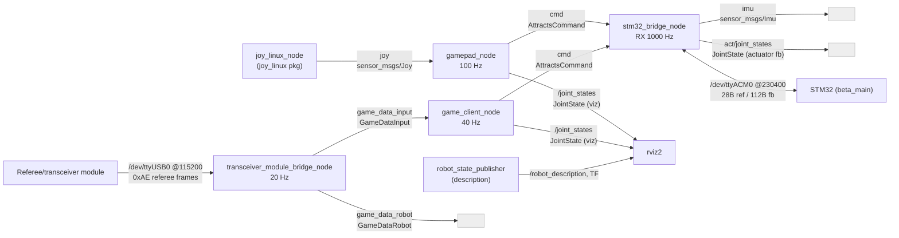

# attracts_ws — ROS 2 Architecture (Current State)

**Status:** Current-state, reverse-engineered from source. This is a description of what the code does today, to seed refactoring discussions — not a target design.

**Date:** 2026-07-19
**Companion:** [`architecture.md`](./2026-07-19-architecture.md) (whole-system overview).

> **Accuracy tags:** **[C]** confirmed in source · **[D]** derived by arithmetic from config · **[I]** inferred from naming/structure. Key source files are cited inline.

---

## 1. Workspace layout

Root: `attracts_ws/`. Six packages, **all `ament_cmake`** [C]. There are **no YAML config files** anywhere in the workspace — all tuning comes from launch arguments or hardcoded constants [C]. Each package is its own git submodule [I].

| Package | Build type | Contents | Depends on (package.xml) |
|---|---|---|---|
| `attracts_msgs` | ament_cmake + rosidl | 3 message definitions (no srv/action) | std_msgs, geometry_msgs |
| `rabcl` | ament_cmake, shared C++ lib | Rabbits Common Library (protocol + drivers + controllers), **no ROS deps** | — |
| `rabcl_ros2` | ament_cmake, shared C++ lib | Thin adapter: ROS msg ↔ `rabcl::Info` | attracts_msgs, rabcl (+ sensor_msgs in CMake) |
| `attracts_interface` | ament_cmake, C++ nodes | The two teleop nodes (**no interface definitions despite the name**) | rclcpp, sensor_msgs, attracts_msgs, rabcl |
| `attracts_bridge` | ament_cmake, C++ nodes | The two serial bridge nodes | rclcpp, attracts_msgs, rabcl, rabcl_ros2 |
| `attracts_description` | ament_cmake, data only | URDF/xacro model, rviz, meshes; no nodes | ros2launch, xacro |

**Latent build issue [C]:** `attracts_bridge` uses and `find_package`s `sensor_msgs`, but `sensor_msgs` is **missing from its `package.xml`** — it builds only by transitive luck via `rabcl_ros2`.

---

## 2. Node graph

Four nodes total. Every topic below uses default QoS (depth 10) unless noted.

### `gamepad_node` — `attracts_interface/src/gamepad_node.cpp` [C]
- **Subscribes:** `joy` (`sensor_msgs/Joy`)
- **Publishes:** `cmd` (`attracts_msgs/AttractsCommand`); `/joint_states` (`sensor_msgs/JointState`, absolute name, for rviz)
- **Timer:** 10 ms → **100 Hz**
- **Parameters:** `max_omni_vel`, `max_omni_rot_vel`, `max_yaw_rot_vel`, `max_pitch_rot_vel` (all default `0.0`). Only the first two are actually read; yaw/pitch use hardcoded divisors (`/10.0`, `/20.0`) [C].
- Hardcoded: `wheel_d_ = 0.06 m`, `body_d_ = 0.28 m`; `speed_mode` hardcoded to `0` [C].

### `game_client_node` — `attracts_interface/src/game_client_node.cpp` [C]
- **Subscribes:** `/game_data_input` (`attracts_msgs/GameDataInput`, absolute name)
- **Publishes:** `cmd` (`attracts_msgs/AttractsCommand`); `/joint_states` (`sensor_msgs/JointState`)
- **Timer:** 25 ms → **40 Hz**
- **Parameters:** same four; again `max_yaw`/`max_pitch` unused (mouse look uses `/400.0`) [C].
- **Rate/const mismatch [C]:** the timer runs at 40 Hz but `UpdatePositions` integrates using `game_client_freq = 20.0` Hz, so the `/joint_states` wheel integration is scaled ~2× wrong. (The gamepad path is self-consistent: 100 Hz timer / `joy_freq = 100.0`.)

### `stm32_bridge_node` — `attracts_bridge/src/stm32_bridge_node.cpp` [C]
- **Subscribes:** `cmd` (`attracts_msgs/AttractsCommand`)
- **Publishes:** `imu` (`sensor_msgs/Imu`); `act/joint_states` (`sensor_msgs/JointState`)
- **Timer:** 1 ms → **1000 Hz** (`ReadTimerCallback`, serial RX drain)
- **Executor:** `MultiThreadedExecutor` (the only node that needs it, because `CmdCB` blocks on `tcdrain()`) [C]
- **Serial:** opens `/dev/ttyACM0` @ `B230400`, 8N1, hardcoded in the constructor [C]
- A second constructor `Stm32Bridge(int test_fd)` injects a fake fd for unit tests [C].

### `transceiver_module_bridge_node` — `attracts_bridge/src/transceiver_module_bridge_node.cpp` [C]
- **Subscribes:** none
- **Publishes:** `game_data_input` (`attracts_msgs/GameDataInput`); `game_data_robot` (`attracts_msgs/GameDataRobot`)
- **Timer:** 1/20 s → **20 Hz**
- **Serial:** opens `/dev/ttyUSB0` @ `B115200`, 8N1, hardcoded [C]
- Failsafe: `control_lost_counter_ > 1000` ticks zeroes the input [C].

All four nodes accept a `rclcpp::NodeOptions` constructor (composition-ready) but are launched **only as standalone executables** — no component registration [C].

### Node/topic graph (Mermaid)



*Note:* `game_data_robot`, `imu`, and `act/joint_states` currently have **no subscribers in-workspace** [C] — they are published for external/logging consumers or future use. This is drawn above as open sinks.

---

## 3. Message definitions [C]

From `attracts_msgs/msg/`. No services or actions exist anywhere in the workspace.

**AttractsCommand.msg** — the unified command carried on `cmd`:
```
std_msgs/Header       header
geometry_msgs/Vector3 chassis_vel      # x, y (translation), z (rotation)
float32               yaw_pos
float32               pitch_pos
uint8                 load_mode         # 0:Stop 1:Forward 2:Reverse
uint8                 fire_mode         # 0:Stop 1:Low 2:High
uint8                 speed_mode        # 0:Low 1:High
uint8                 chassis_mode      # 0:Normal 1:InfiniteRot
```

**GameDataInput.msg** — `int16 mouse_delta_x`, `int16 mouse_delta_y`, 5 mouse-button bools, and ~30 keyboard bools (key_1..5, tab, q/w/e/r/t, a/s/d/f/g/h, shift, z/x/c/v/b, ctrl, alt, space, enter).

**GameDataRobot.msg**:
```
uint8  type                  # 0:Tank 1:Assault 2:Marksman
uint8  team                  # 0:A 1:B
uint8  projectile_speed_max  # [m/s]
uint16 max_hp
uint16 current_hp
uint16 max_heat
uint16 current_heat
```

---

## 4. Launch structure [C]

| Launch file | Starts | Args / notes |
|---|---|---|
| `attracts_interface/launch/gamepad.launch.py` | `joy_linux_node` (autorepeat 100 Hz) + `gamepad_node` | args `max_omni_vel=0.4`, `max_omni_rot_vel=1.0`, `max_yaw_rot_vel=2.0`, `max_pitch_rot_vel=2.0` |
| `attracts_interface/launch/game_client.launch.py` | `game_client_node` only | same four args; **does not** start the transceiver bridge that feeds it |
| `attracts_bridge/launch/stm32_bridge.launch.py` | `stm32_bridge_node` | no params/remaps |
| `attracts_bridge/launch/transceiver_module_bridge.launch.py` | `transceiver_module_bridge_node` | — |
| `attracts_bridge/launch/stm32_bringup.launch.py` (top-level) | gamepad + stm32_bridge + transceiver_module_bridge | the `game_client.launch.py` include is present but **commented out** → default bring-up is the gamepad path |
| `attracts_description/launch/display.launch.py` | robot_state_publisher (expands `urdf/proto1.xacro` at launch), optional joint_state_publisher_gui (`use_gui`), rviz2 | viz only |

No remappings and no composition anywhere; every node is its own process [C].

---

## 5. Data flow: gamepad input → bridge → STM32 [C]

Every hop below is confirmed in code. Message type is named at each stage.

1. **`joy_linux_node`** publishes `joy` (`sensor_msgs/Joy`) at 100 Hz (autorepeat).
2. **`gamepad_node.TimerCB` @100 Hz** maps axes/buttons into an `AttractsCommand`:
   - chassis translation/rotation scaled by `max_omni_vel` / `max_omni_rot_vel`;
   - `yaw_pos`, `pitch_pos` integrated from stick input (hardcoded sensitivities);
   - `load_mode` / `fire_mode` / `chassis_mode` from buttons; `speed_mode` hardcoded 0.
   It publishes `cmd` (`AttractsCommand`) and, separately, `/joint_states` (`JointState`) computed via `rabcl::OmniDrive::CalcVel` forward-integration — for rviz only, not sent to hardware.
3. **`stm32_bridge_node.CmdCB`** (subscribed to `cmd`):
   - `rabcl_ros2::Utils::CmdMsgToInfo(AttractsCommand, Info&)` copies fields into the shared `rabcl::Info`;
   - `rabcl::Uart::PrepareReferencePacket(info)` encodes the 28-byte frame (`0xA5 0x5A`, five big-endian float32s, four mode bytes, XOR "CRC8", pad);
   - `write(fd, buf, 28)` then `tcdrain()` flushes to `/dev/ttyACM0` @230400 (blocking, inside the callback).
4. **STM32** decodes, runs its control loops, and streams a 112-byte feedback frame (`0xB5 0x5B`, 27 float32s) back.
5. **`stm32_bridge_node.ReadTimerCallback` @1000 Hz** runs an inline `SCAN_H0 → SCAN_H1 → READ_REMAIN` state machine, decodes via `rabcl::Uart::UpdateFeedbackData`, and on valid checksum publishes `imu` (euler→quaternion, `frame_id="imu_link"`) and `act/joint_states` (joints `yaw, pitch, chassis_fr/fl/br/bl`).

The in-process representation between ROS and the wire is always `rabcl::Info`; the wire is a raw fixed-size byte frame. `rabcl_ros2` is the **only** ROS-aware code that touches messages (`CmdMsgToInfo`, `InfoToImuMsg`, `InfoToJointStateMsg`) [C].

**Kinematics** (`rabcl/src/controller/omni_drive.cpp`, shared with firmware): 4-wheel omni inverse kinematics `CalcVel(vx, vy, vz → fr, fl, br, bl)`, wheels at ±45°/±135°, plus a rotation term `vz·body_d/wheel_d` [C].

**Alternate source:** `/dev/ttyUSB0 @115200` → `transceiver_module_bridge_node` → `game_data_input` → `game_client_node` → same `cmd`. So `gamepad_node` and `game_client_node` are **two interchangeable `cmd` publishers**; nothing enforces that only one runs [C].

---

## 6. Improvement opportunities (discussion points)

Framed as candidates for discussion, not prescriptions. All grounded in observations above.

**Naming vs. contents.** `attracts_interface` holds teleop *nodes*, not interface definitions, and `rabcl` (a host-usable subset) is bundled with firmware-only drivers. Do the package boundaries still match responsibilities, or would splitting "host-usable protocol/kinematics" from "MCU-only drivers" clarify the dependency graph? [C]

**`rabcl` is an over-broad shared library.** The ROS side links a shared `.so` that also contains CAN/DM/LK motor drivers, BNO055, servo, and DC-motor code that only ever run on the STM32 [C]. Plus the vendored firmware copies have already diverged from the workspace copy [C]. Worth discussing: a clear "portable core" (protocol structs, omni_drive) vs. "platform drivers" split, and a single-source-of-truth strategy (submodule / generated headers) so host and every MCU stay in sync.

**Configuration is hardcoded.** Serial device names (`/dev/ttyACM0`, `/dev/ttyUSB0`) and baud rates are literals in constructors — not ROS params, not launch args [C]. Swapping a port requires a recompile. A thin config layer (params + a shared config file) is a natural discussion item, especially since the workspace currently has *no* YAML config at all.

**Two `cmd` publishers, no arbitration.** `gamepad_node` and `game_client_node` can both drive `cmd` with nothing enforcing exclusivity [C]. An explicit command mux / priority (operator vs. game-server) with a single owner of `cmd` would remove a foot-gun and make intent explicit.

**Overloaded / ambiguous topic names.** `/joint_states` (absolute, from teleop, kinematic viz) and `act/joint_states` (relative, from bridge, actuator feedback with different joint names) mean different things under confusingly similar names [C]. Downstream consumers (rviz, loggers, future autonomy) would benefit from distinct, clearly-scoped names.

**Declared-but-unused parameters and silent-failure defaults.** `max_yaw_rot_vel` / `max_pitch_rot_vel` are declared but never read; turret sensitivities are hardcoded instead [C]. Teleop param defaults are `0.0`, so a node launched without its launch file silently won't move [C]. Both are worth resolving so the parameter surface reflects reality and misconfiguration fails loudly.

**The 40 Hz / 20 Hz integration bug.** `game_client_node` integrates positions with the wrong frequency constant relative to its timer, so its `/joint_states` velocities are ~2× off [C]. Small, but a concrete correctness item — and an argument for deriving the integration `dt` from the actual timer period rather than a separate literal.

**Integrity checking on the primary link.** The STM32 UART "CRC8" is a byte-wise XOR (single-bit-error detection) [C], while the referee link uses real CRC8+CRC16 [C]. For a link carrying live motor commands, is XOR sufficient, or should the primary link adopt the stronger checks already implemented next door?

**Blocking I/O and polling in the bridge.** `CmdCB` blocks on `tcdrain()`, and RX is a 1 kHz polling timer rather than event-driven serial — hence the `MultiThreadedExecutor` [C]. Event-driven serial (or a dedicated I/O thread with a queue) could reduce jitter and remove the need to reason about callback blocking.

**Composition left on the table.** All nodes are `NodeOptions`-aware but always run as separate processes [C]. If intra-host latency or process overhead ever matters, component composition (esp. teleop + bridge in one container) is available with little change.

**Testability — a relative bright spot, with one seam gap.** The code already compiles nodes into test libraries (`*_EXCLUDE_MAIN` macros), injects a fake fd via `Stm32Bridge(int test_fd)`, and keeps CRC/frame parsing `static`; gtest suites exist for CRC, frame processing, both bridges, and both teleop nodes, plus the rabcl modules [C]. The main gap is that the *default* bridge constructors open real hardware, so full-node tests still depend on the injection seam — a candidate for a cleaner hardware-abstraction boundary (e.g. a serial-port interface) if broader integration testing is wanted.

---

## 7. Key source references

- Command message: `attracts_msgs/msg/AttractsCommand.msg`
- Teleop: `attracts_interface/src/gamepad_node.cpp`, `.../game_client_node.cpp`
- Bridges: `attracts_bridge/src/stm32_bridge_node.cpp`, `.../transceiver_module_bridge_node.cpp`
- Protocol: `rabcl/include/rabcl/interface/uart.hpp`, `rabcl/src/interface/uart.cpp`
- Kinematics: `rabcl/src/controller/omni_drive.cpp`
- Shared state model: `rabcl/include/rabcl/utils/type.hpp`
- ROS adapter: `rabcl_ros2/src/utils.cpp`
- Bring-up: `attracts_bridge/launch/stm32_bringup.launch.py`
